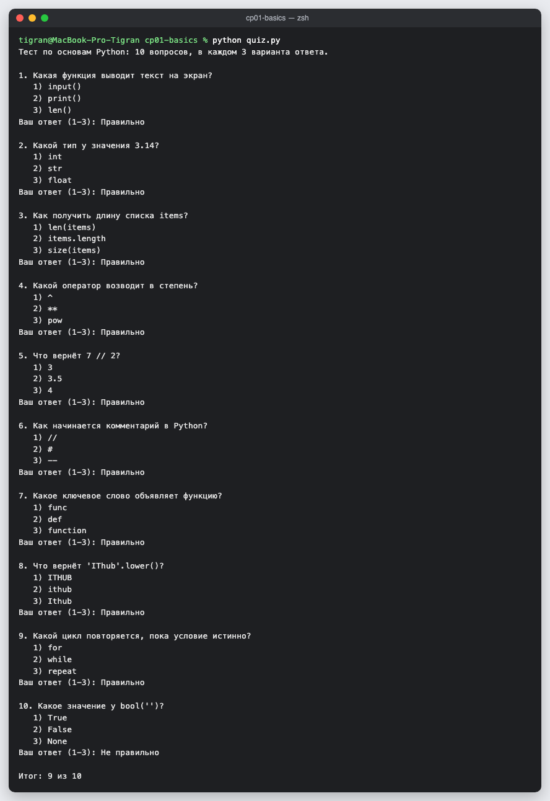
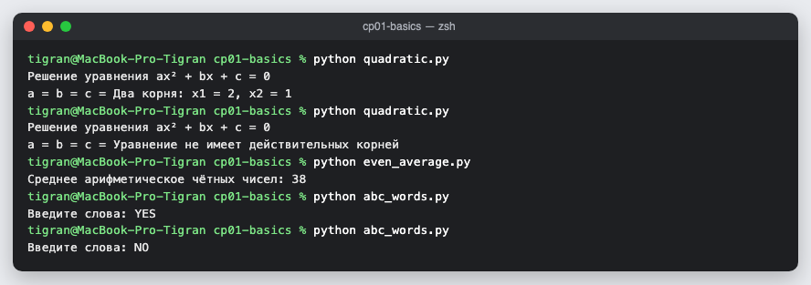

# КТ 1. Функции ввода-вывода, строки, управляющие конструкции

Тест на 10 вопросов с тремя вариантами ответа; решение квадратного уравнения; среднее чётных чисел до числа 100; проверка, что все слова начинаются с A, B или C.

| Файл | Задача |
|---|---|
| `quiz.py` | тест по основам Python: «Правильно» или «Не правильно» после каждого ответа и итог |
| `quadratic.py` | корни ax² + bx + c = 0 через дискриминант, случаи двух, одного корня и отсутствия корней |
| `even_average.py` | читает числа до 100 и выводит среднее чётных, включая 100 |
| `abc_words.py` | YES, если все слова начинаются с A, B или C, иначе NO |

## Запуск

```
python3 quiz.py
python3 quadratic.py
python3 even_average.py
python3 abc_words.py
```

## Скриншоты



