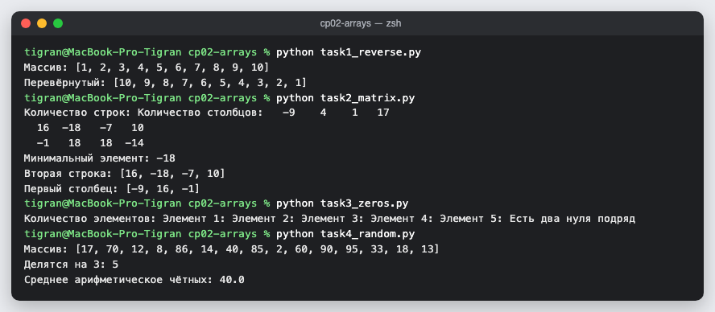

# КТ 2. Работа с упорядоченными и структурированными данными

Четыре задачи на одномерные и двумерные массивы.

| Файл | Задача |
|---|---|
| `task1_reverse.py` | массив 1…10, вывод и разворот |
| `task2_matrix.py` | матрица заданного размера со случайными числами от −20 до 20: минимум, вторая строка, первый столбец |
| `task3_zeros.py` | есть ли в массиве два нуля подряд |
| `task4_random.py` | сколько чисел делится на 3 и среднее чётных |

## Запуск

```
python3 task1_reverse.py
python3 task2_matrix.py
python3 task3_zeros.py
python3 task4_random.py
```

## Скриншоты


