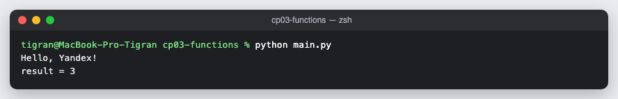

# КТ 3. Функции и модули

Функция `print_hello(name)` печатает приветствие, функция `gcd(a, b)` возвращает наибольший общий делитель по алгоритму Евклида. Обе лежат в модуле `greetings.py` и импортируются в `main.py`.

## Запуск

```
python3 main.py
```

## Скриншоты


