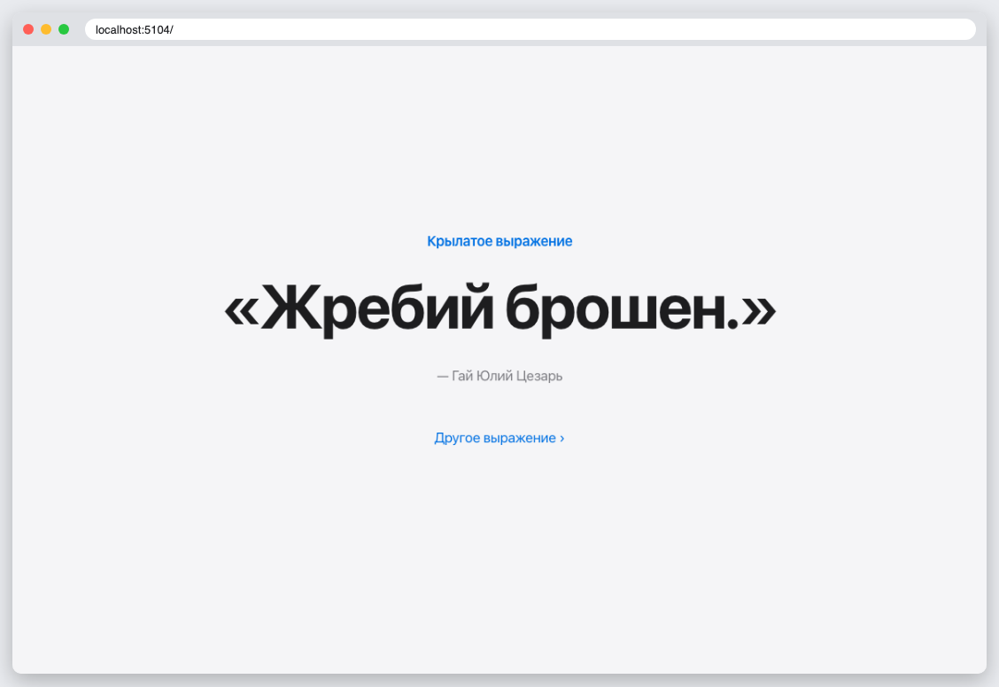

# КТ 4. Введение во Flask

Flask-приложение выводит в браузере крылатое выражение; при каждом обновлении — случайное из списка.

## Запуск

```
python3 -m venv .venv
source .venv/bin/activate
pip install -r requirements.txt
flask --app app run
```

## Скриншоты


