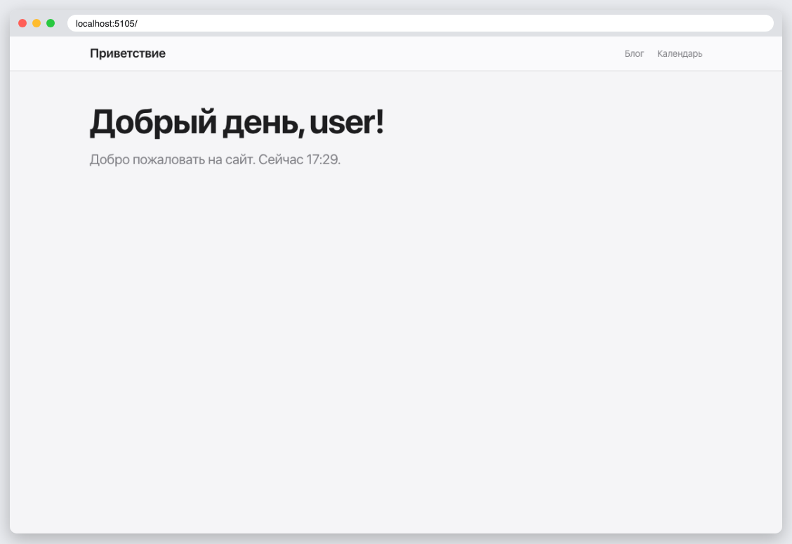
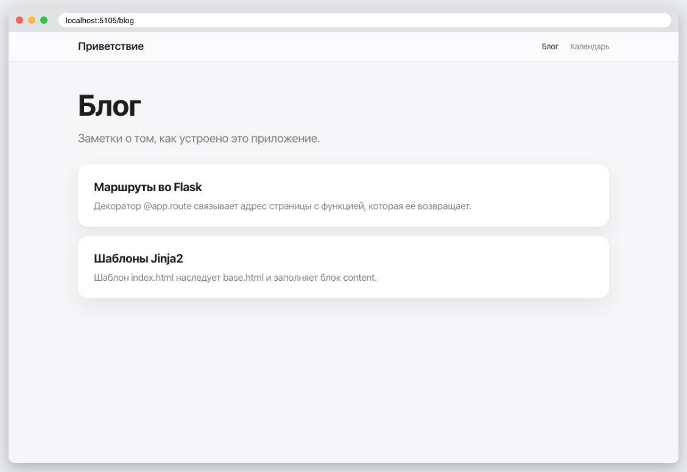
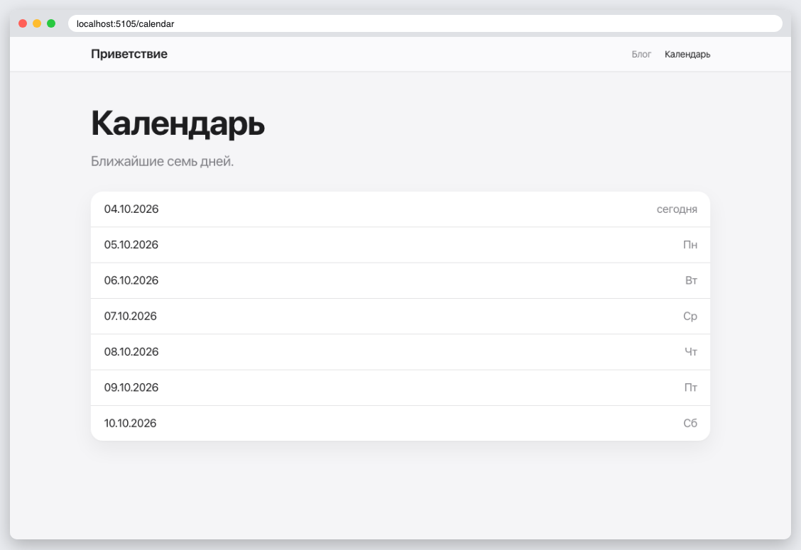

# КТ 5. Маршруты во Flask

Шаблон `index.html` наследует `base.html` и показывает приветствие по времени суток: 6–12 «Доброе утро», 12–18 «Добрый день», 18–24 «Добрый вечер», 0–6 «Доброй ночи». В шапке маршруты «Блог» и «Календарь».

## Запуск

```
python3 -m venv .venv
source .venv/bin/activate
pip install -r requirements.txt
flask --app app run
```

## Скриншоты




