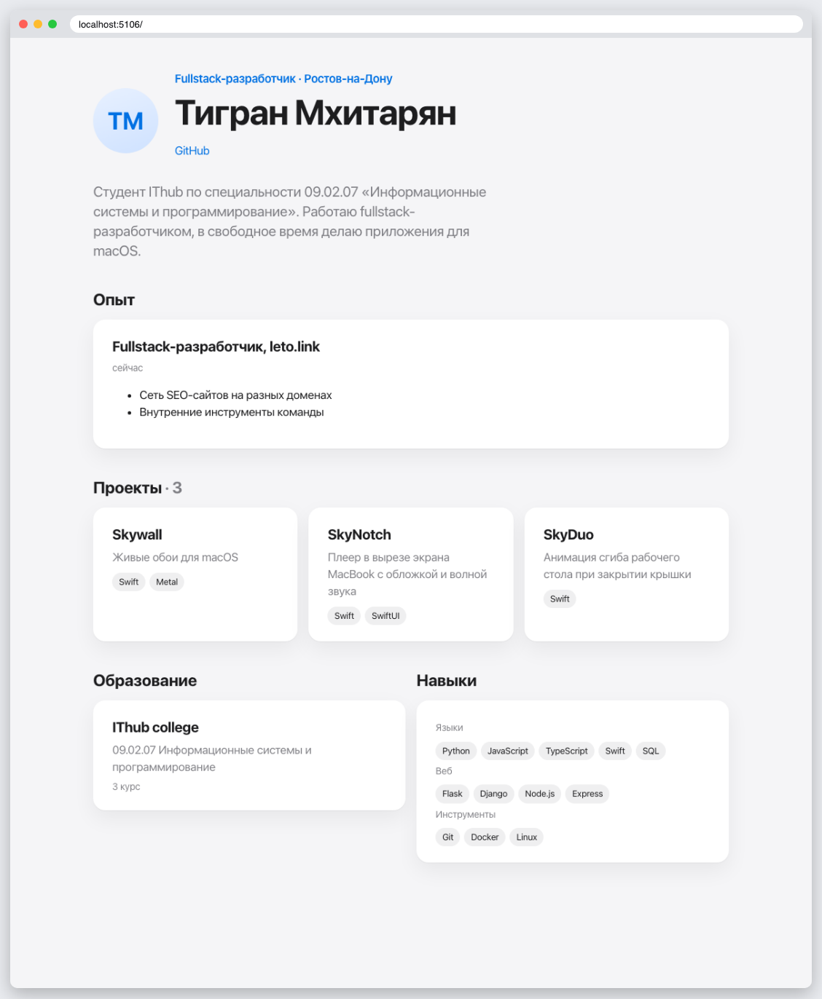

# КТ 6. Шаблонизатор Jinja2

Резюме на Jinja2: наследование шаблонов, циклы, условия, фильтры и макрос `tags` для списка навыков. Данные резюме лежат в словаре в `app.py`.

## Запуск

```
python3 -m venv .venv
source .venv/bin/activate
pip install -r requirements.txt
flask --app app run
```

## Скриншоты


