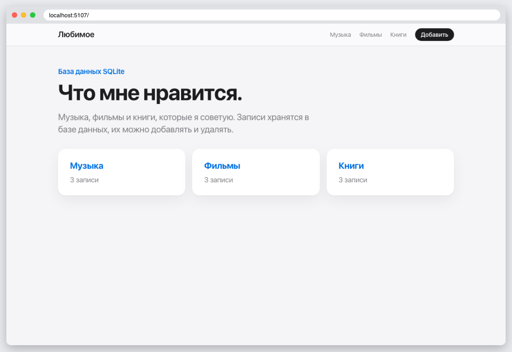
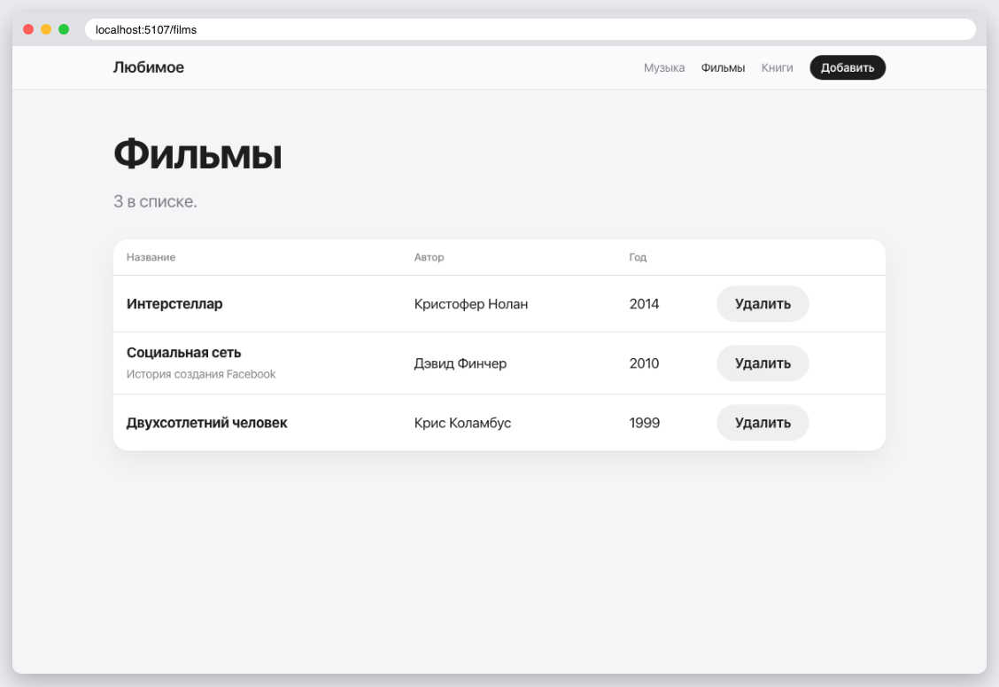
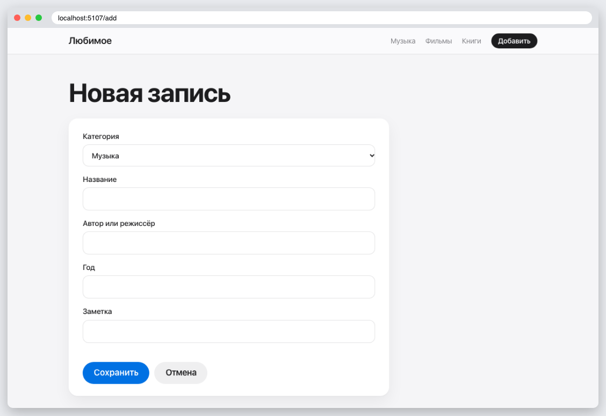

# КТ 7. Использование базы данных

База SQLite через Flask-SQLAlchemy с моими предпочтениями: музыка, фильмы, книги. Записи можно смотреть по категориям, добавлять и удалять.

## Запуск

```
python3 -m venv .venv
source .venv/bin/activate
pip install -r requirements.txt
flask --app app seed
flask --app app run
```

## Скриншоты




