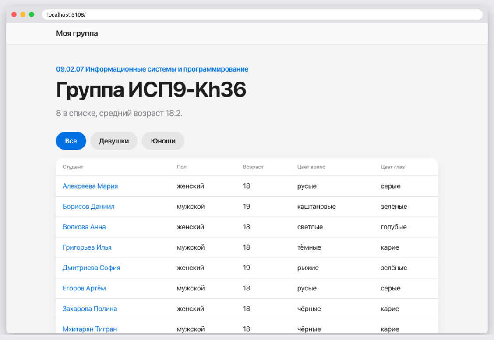
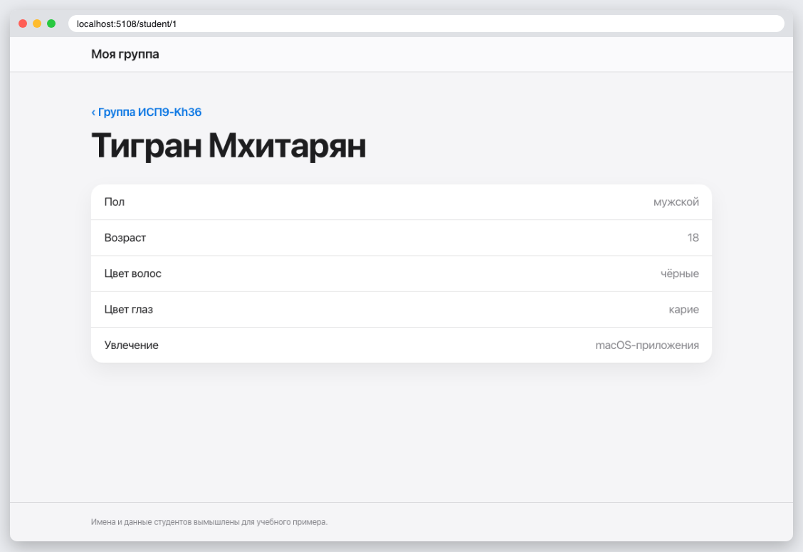
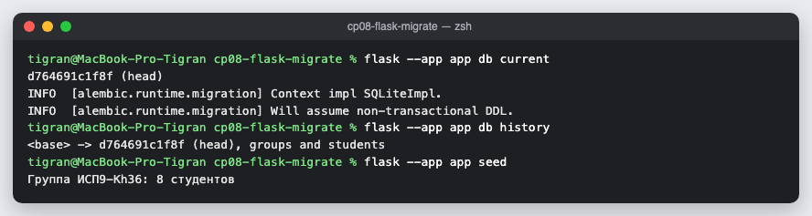

# КТ 8. Миграция базы данных

База группы на Flask-SQLAlchemy с миграциями Flask-Migrate: модели `Group` и `Student` связаны «один ко многим». У студента пол, возраст, цвет волос и глаз, увлечение. Есть фильтр по полу и страница студента. Имена и данные вымышлены.

Папка `migrations` создана командами `flask db init` и `flask db migrate`, таблицы создаёт `flask db upgrade`.

## Запуск

```
python3 -m venv .venv
source .venv/bin/activate
pip install -r requirements.txt
flask --app app db upgrade
flask --app app seed
flask --app app run
```

## Скриншоты




