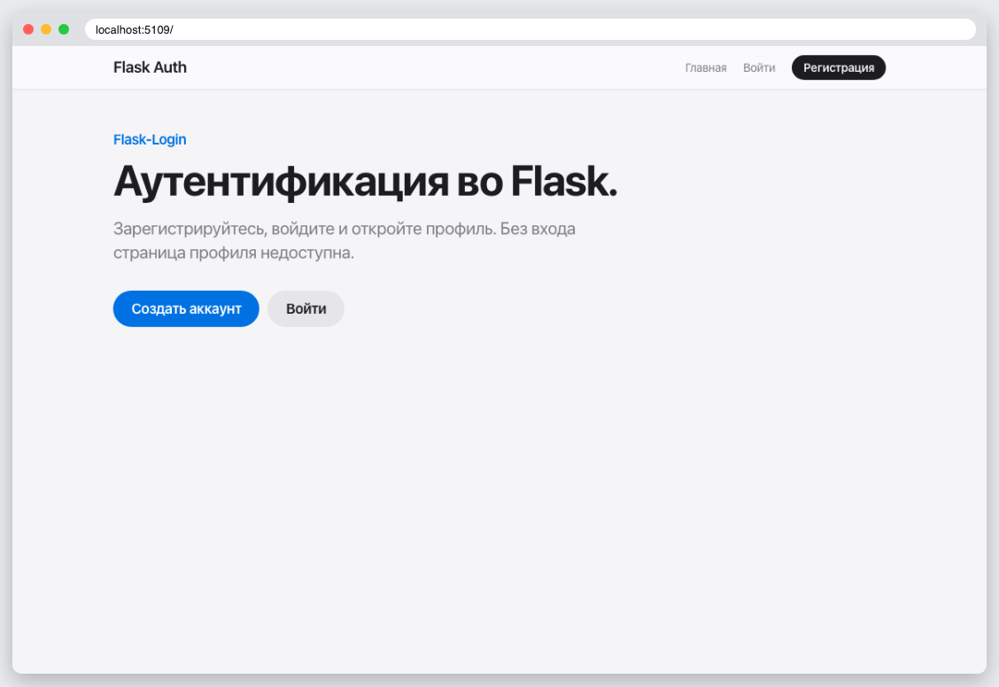
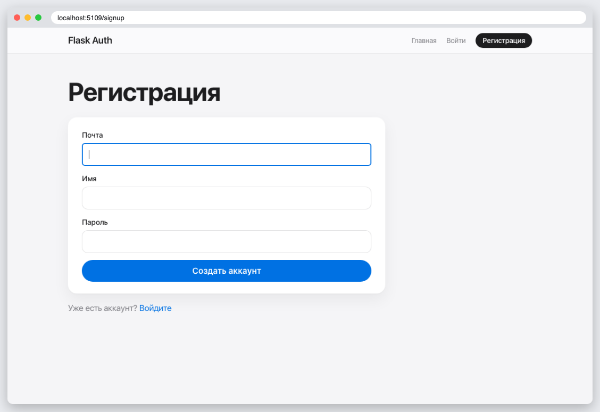
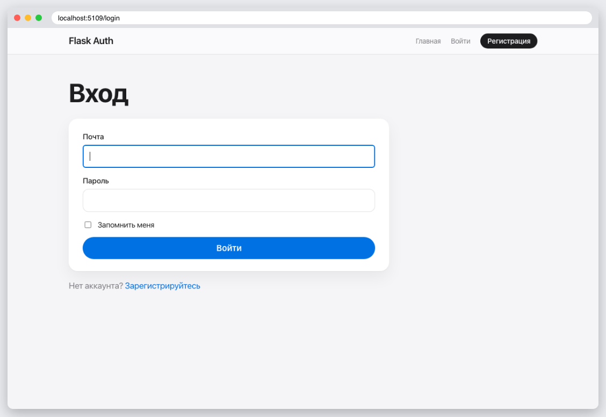
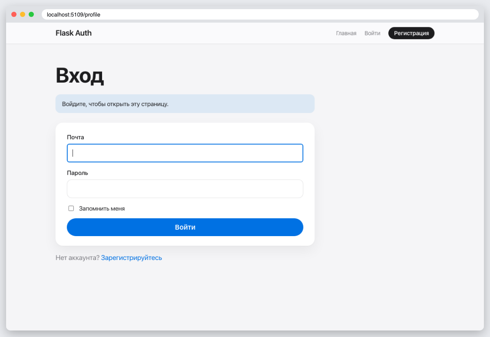
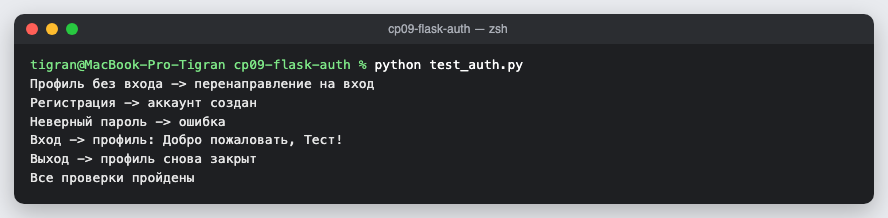

# КТ 9. Добавление аутентификации

Все шаги урока: пакет `project` с фабрикой `create_app`, модель `User`, блюпринты `auth` и `main`, регистрация с хешированием пароля, вход через Flask-Login, защита страницы профиля декоратором `@login_required`, выход. Сценарий проверяет `test_auth.py`.

## Запуск

```
python3 -m venv .venv
source .venv/bin/activate
pip install -r requirements.txt
flask --app project run
python test_auth.py
```

## Скриншоты






