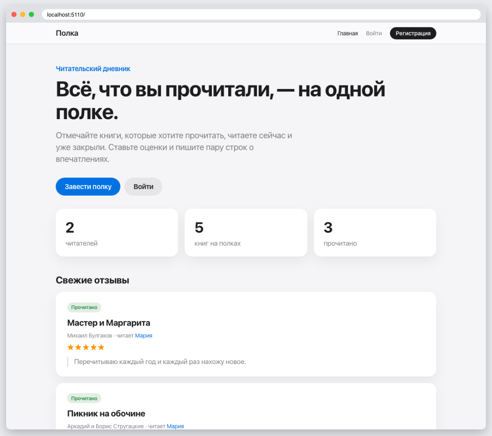
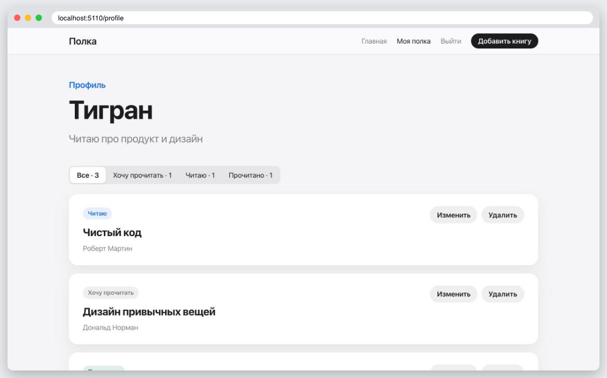
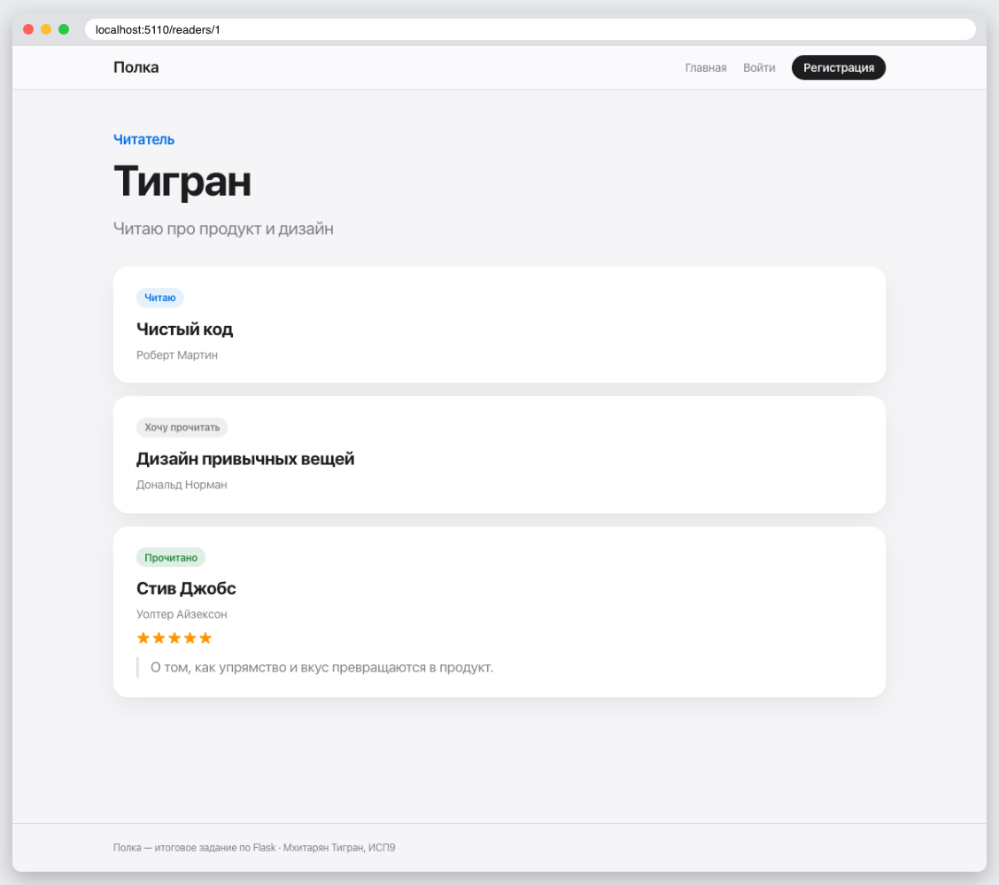
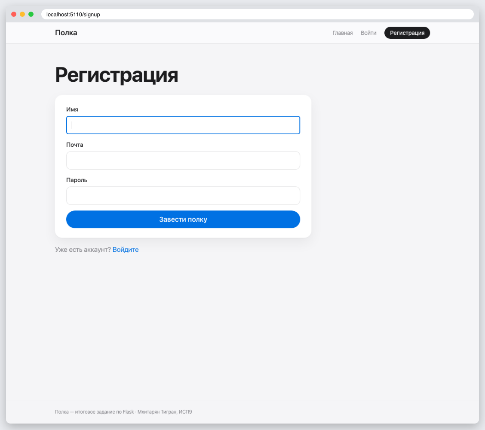
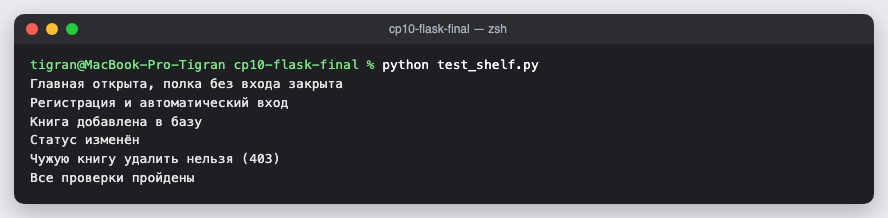

# КТ 10. Создание веб-приложения на Flask — итоговое задание

«Полка» — читательский дневник.

| Требование | Как выполнено |
|---|---|
| Несколько страниц | главная со статистикой и отзывами, моя полка (профиль) с фильтром, страница читателя, добавление и редактирование книги, вход и регистрация |
| Шаблоны | общий `base.html`, подшаблон карточки `_book.html` |
| База данных | SQLite через SQLAlchemy: пользователи и книги «один ко многим» |
| Аутентификация | регистрация, вход, выход через Flask-Login; книги может менять только владелец |

Демо-аккаунты после `flask --app app seed`: `tigran@example.com` и `maria@example.com`, пароль `password123`.

## Запуск

```
python3 -m venv .venv
source .venv/bin/activate
pip install -r requirements.txt
flask --app app seed
flask --app app run
python test_shelf.py
```

## Скриншоты






