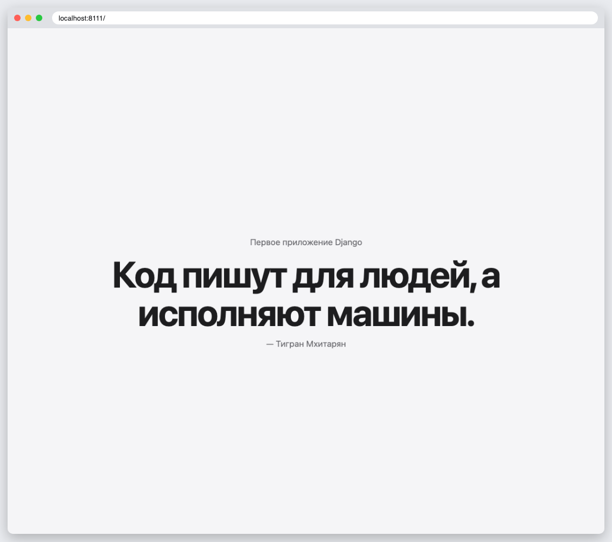
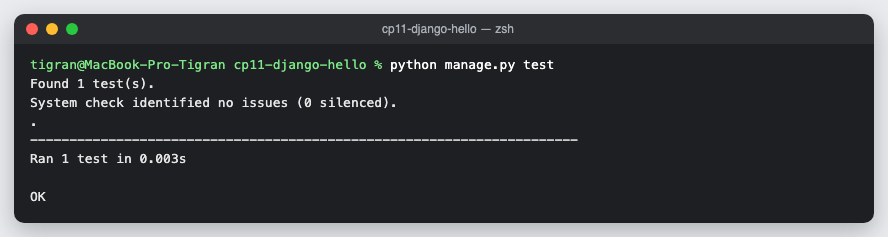

# КТ 11. Первое приложение Django

Проект `django_project` и приложение `pages`: представление `home_page_view` возвращает страницу с моей фразой «Код пишут для людей, а исполняют машины.» Проверено тестом.

## Запуск

```
python3 -m venv .venv
source .venv/bin/activate
pip install -r requirements.txt
python manage.py runserver
python manage.py test
```

## Скриншоты



