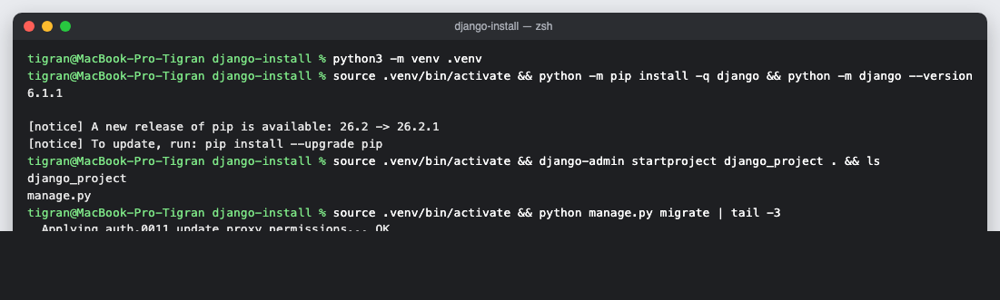
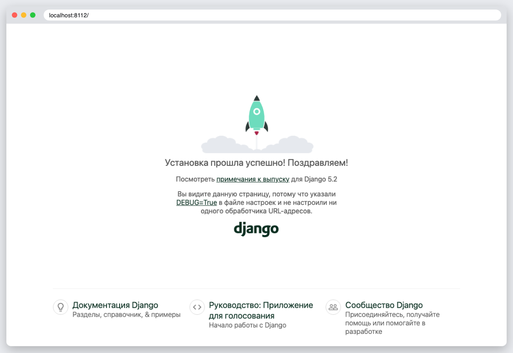

# КТ 12. Знакомство с веб-фреймворком Django

Установка Django в виртуальной среде и отдельном каталоге. Шаги:

```
mkdir django-install && cd django-install
python3 -m venv .venv
source .venv/bin/activate
python -m pip install django
python -m django --version
django-admin startproject django_project .
python manage.py migrate
python manage.py runserver
```

В папке — проект сразу после `startproject`, на скриншоте `install` — реальный вывод этих команд, на `rocket` — стартовая страница Django.

## Запуск

```
python3 -m venv .venv
source .venv/bin/activate
pip install -r requirements.txt
python manage.py runserver
```

## Скриншоты



