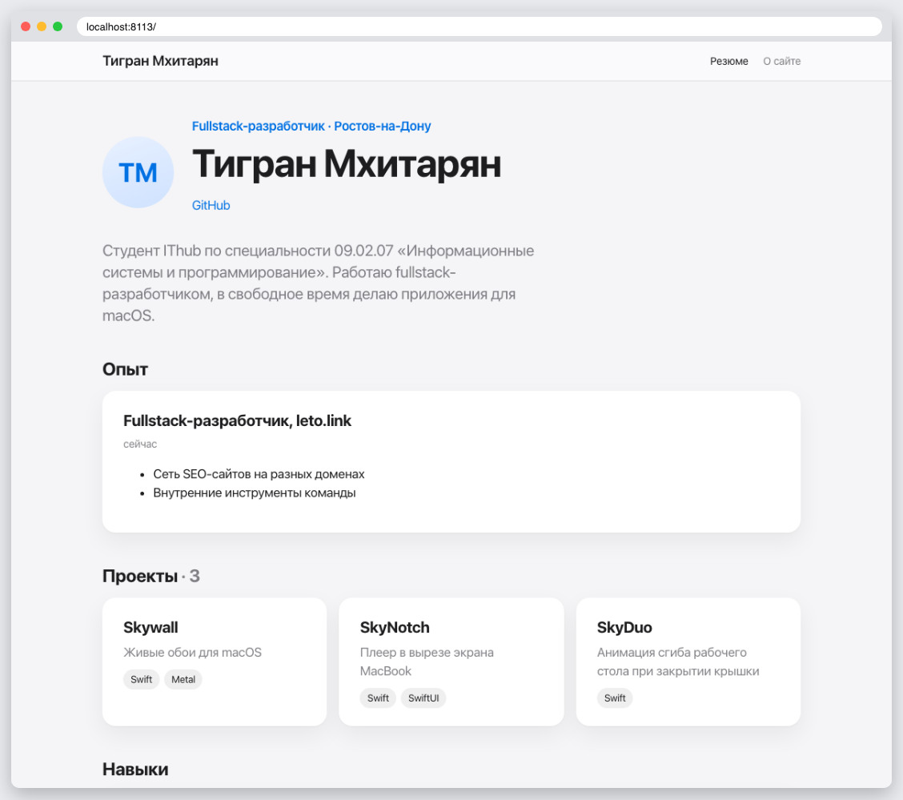
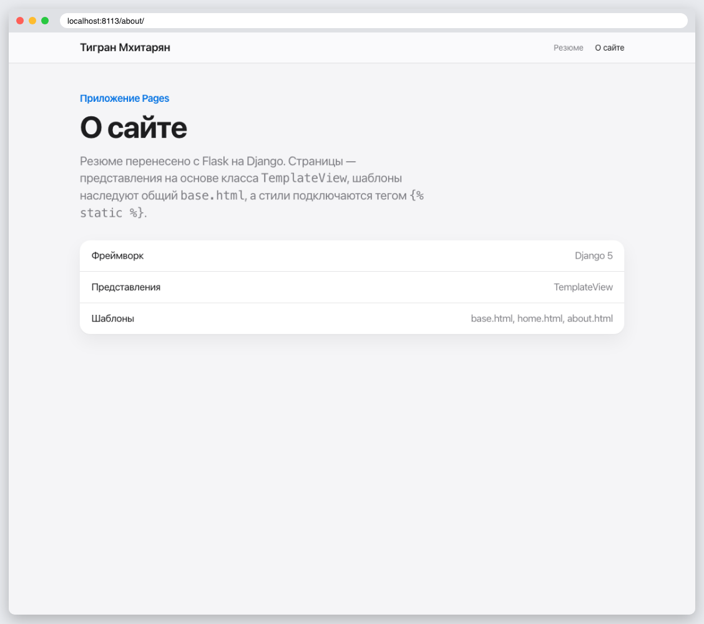
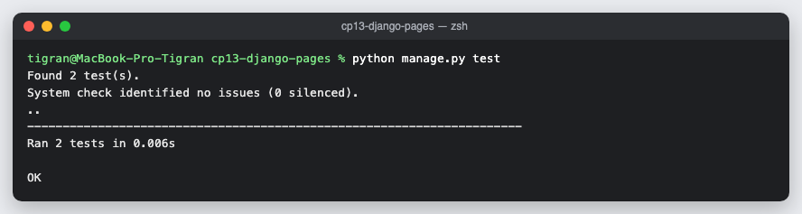

# КТ 13. Приложение Pages

Резюме из работ с Flask перенесено в Django: представления `TemplateView`, шаблоны `base.html`, `home.html`, `about.html`, общий CSS через ``. Проверено тестами.

## Запуск

```
python3 -m venv .venv
source .venv/bin/activate
pip install -r requirements.txt
python manage.py runserver
python manage.py test
```

## Скриншоты




