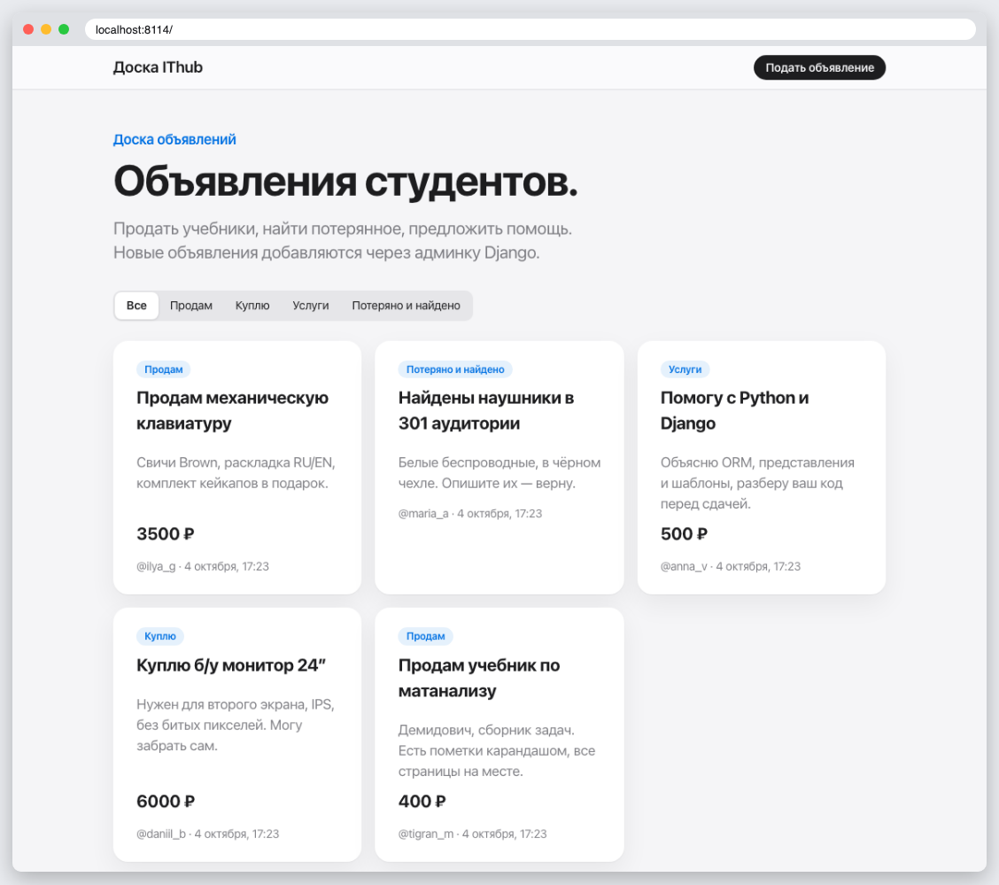
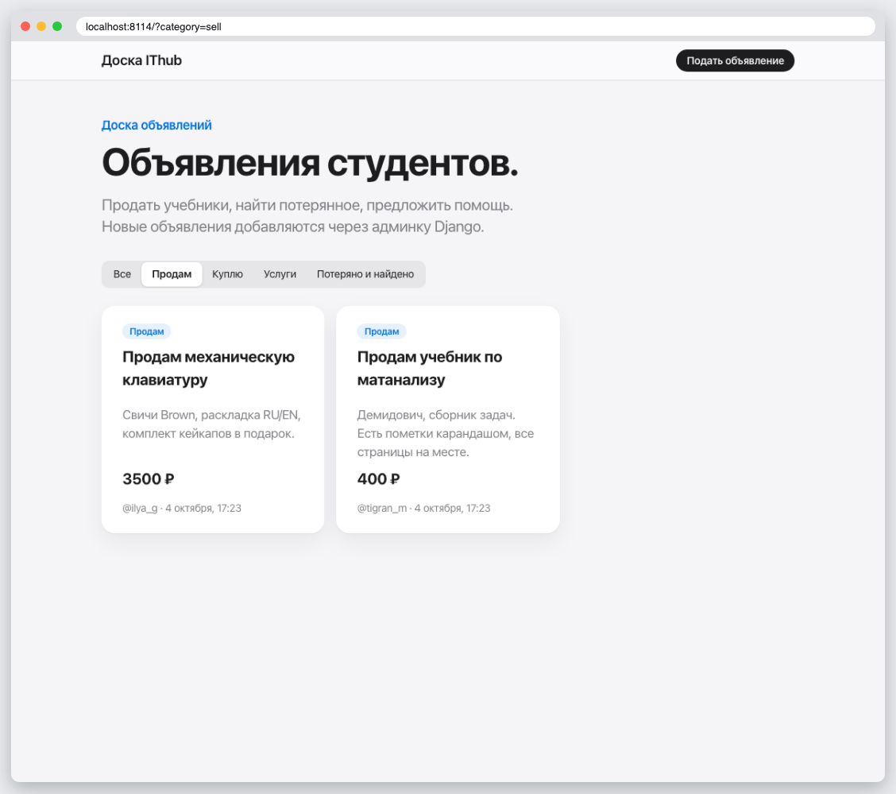
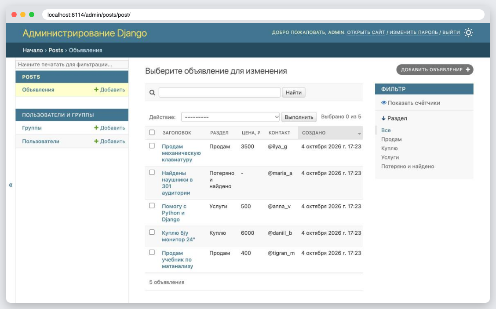
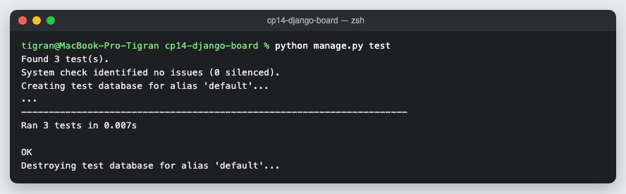

# КТ 14. Приложение «Доска объявлений»

Модель `Post` с разделом, ценой и контактом, регистрация в админке с фильтром и поиском, `ListView` с фильтром по разделам. Пять объявлений создаёт миграция `0002_seed_posts` — они появляются сразу после `migrate`. Новые объявления добавляются через админку.

## Запуск

```
python3 -m venv .venv
source .venv/bin/activate
pip install -r requirements.txt
python manage.py migrate
python manage.py createsuperuser
python manage.py runserver
python manage.py test
```

## Скриншоты





