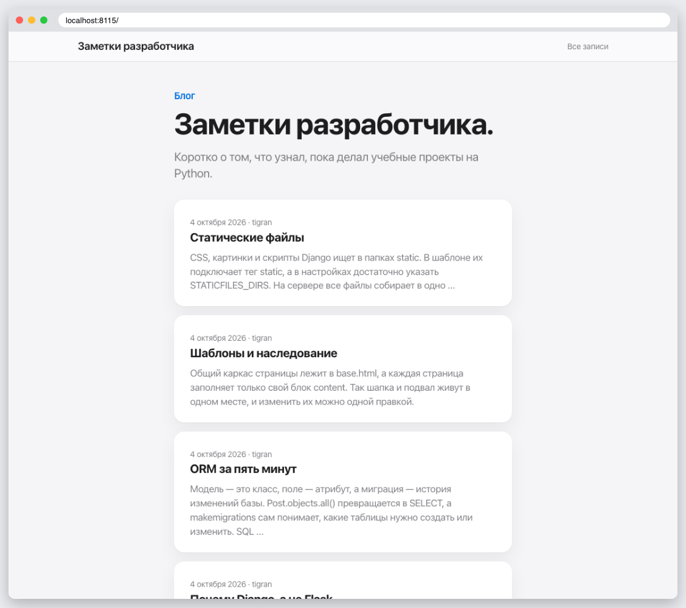
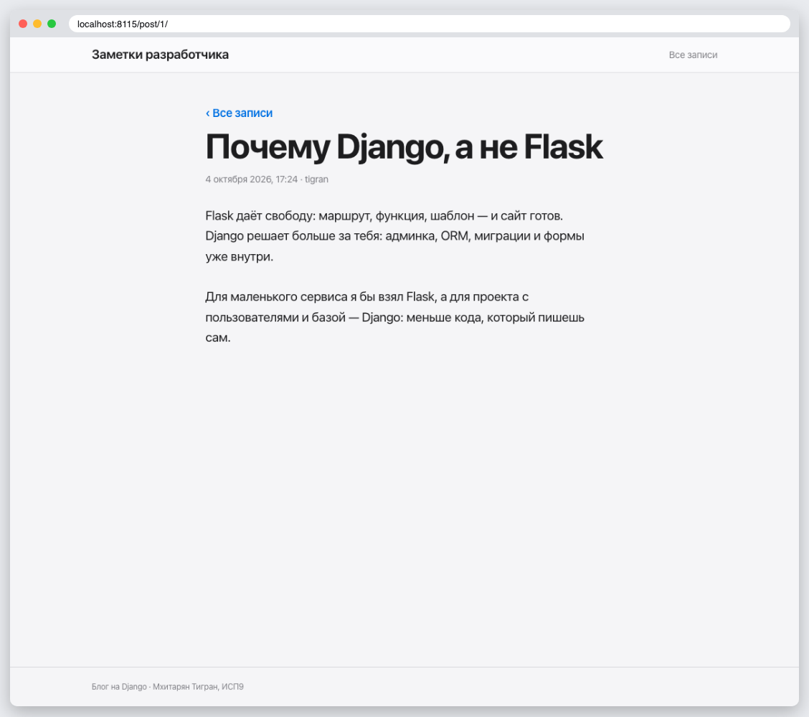
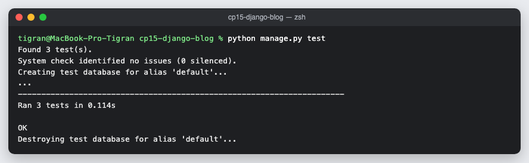

# КТ 15. Приложение «Блог»

Блог: модель `Post` с автором, `ListView` и `DetailView`, статические файлы в `static/css`. Четыре записи создаёт миграция `0002_seed_posts`.

## Запуск

```
python3 -m venv .venv
source .venv/bin/activate
pip install -r requirements.txt
python manage.py migrate
python manage.py runserver
python manage.py test
```

## Скриншоты




