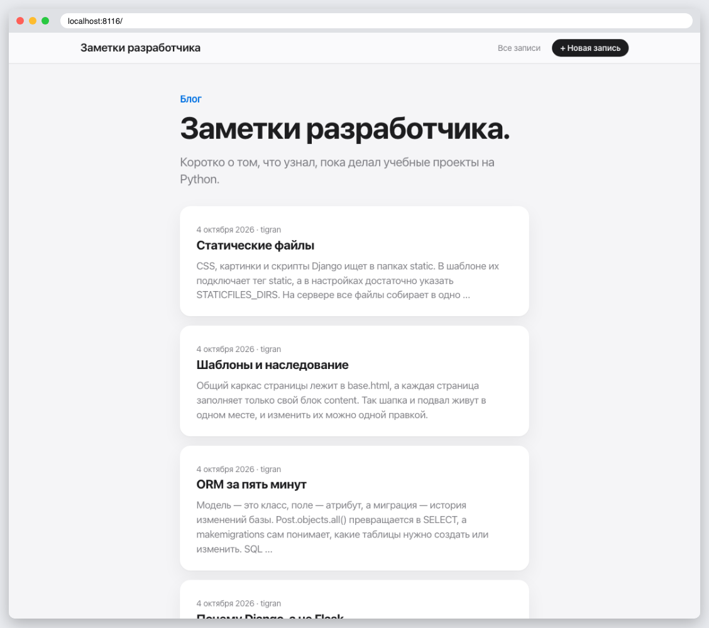
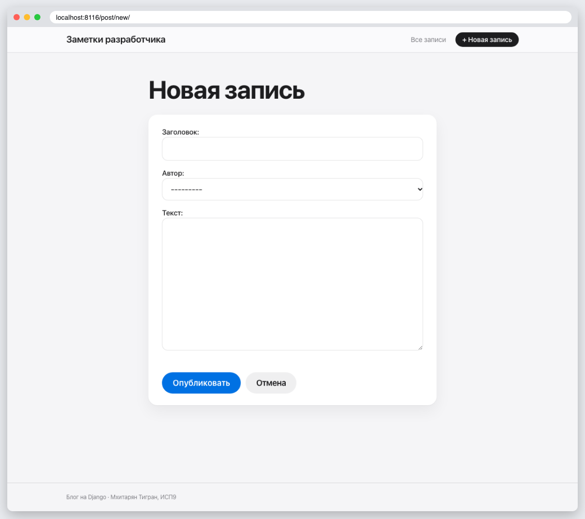
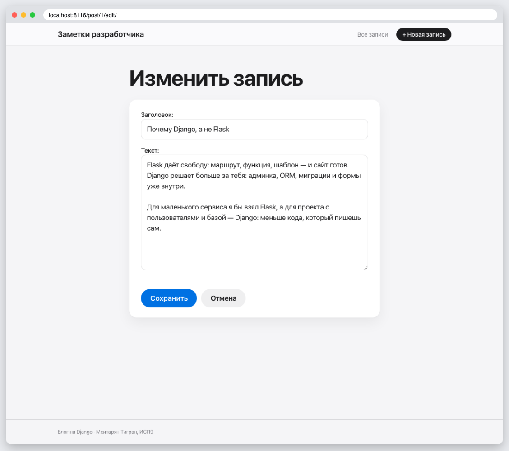
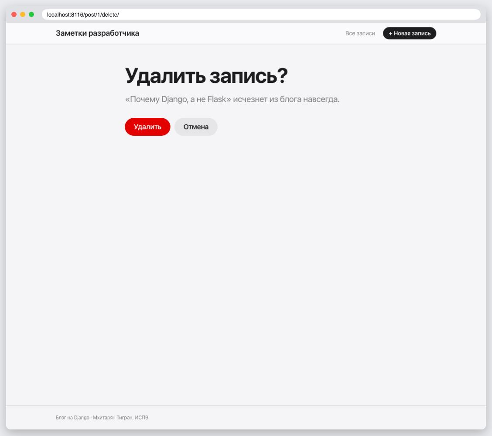
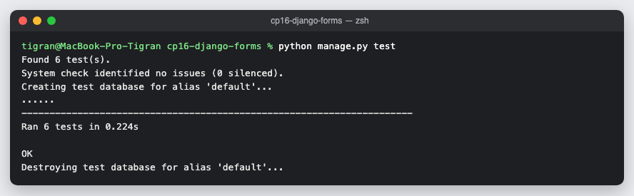

# КТ 16. Формы

Блог из КТ 15, к которому подключены все кнопки: «+ Новая запись» (`CreateView`), «Изменить» (`UpdateView`), «Удалить» с подтверждением (`DeleteView`). Тесты проверяют создание, изменение и удаление.

## Запуск

```
python3 -m venv .venv
source .venv/bin/activate
pip install -r requirements.txt
python manage.py migrate
python manage.py runserver
python manage.py test
```

## Скриншоты






