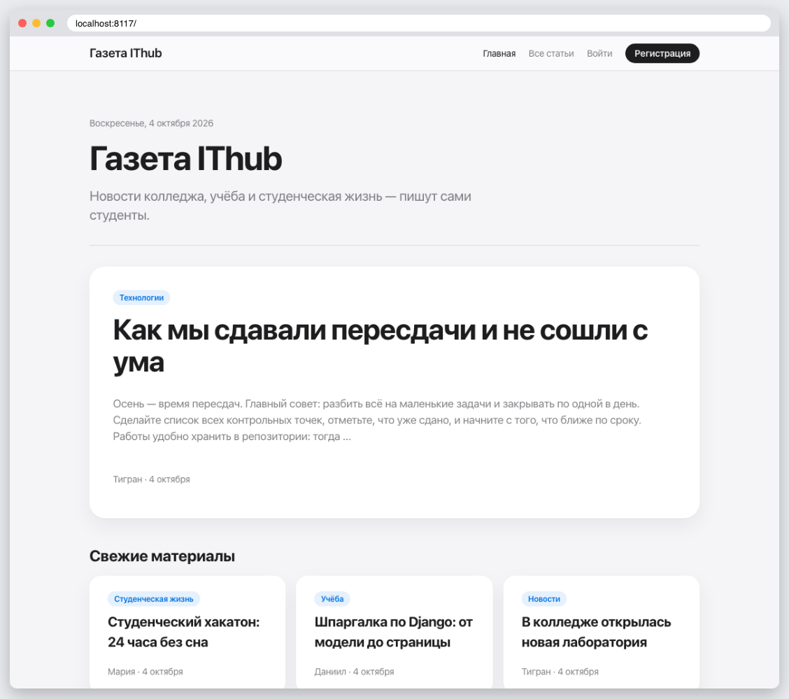
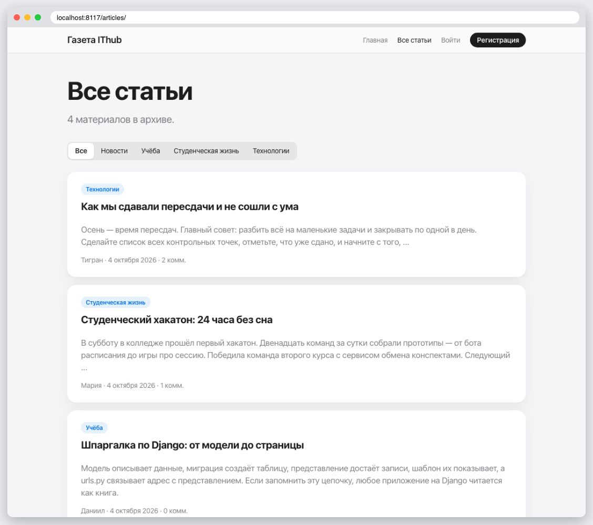
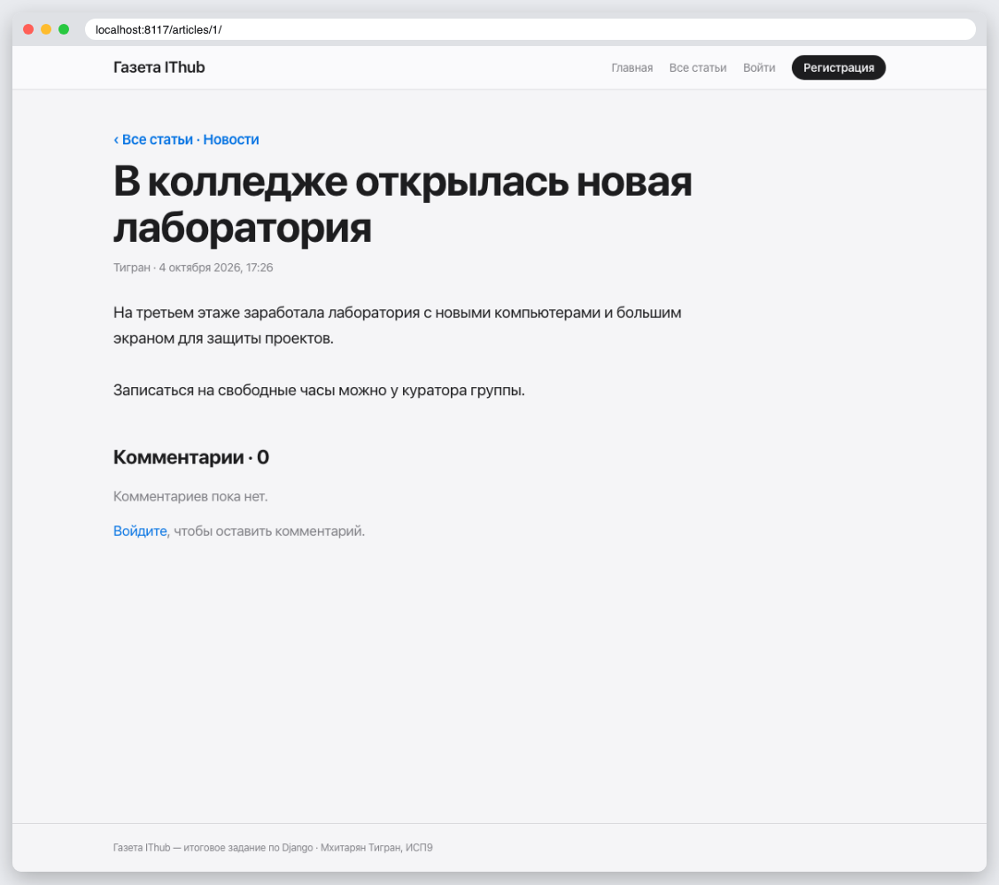
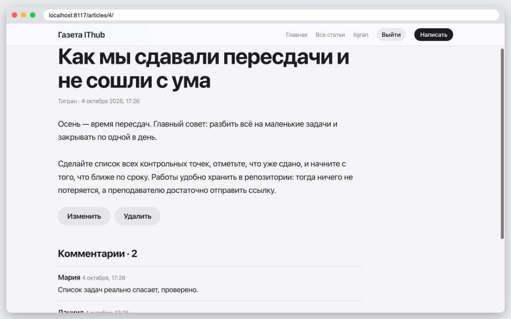
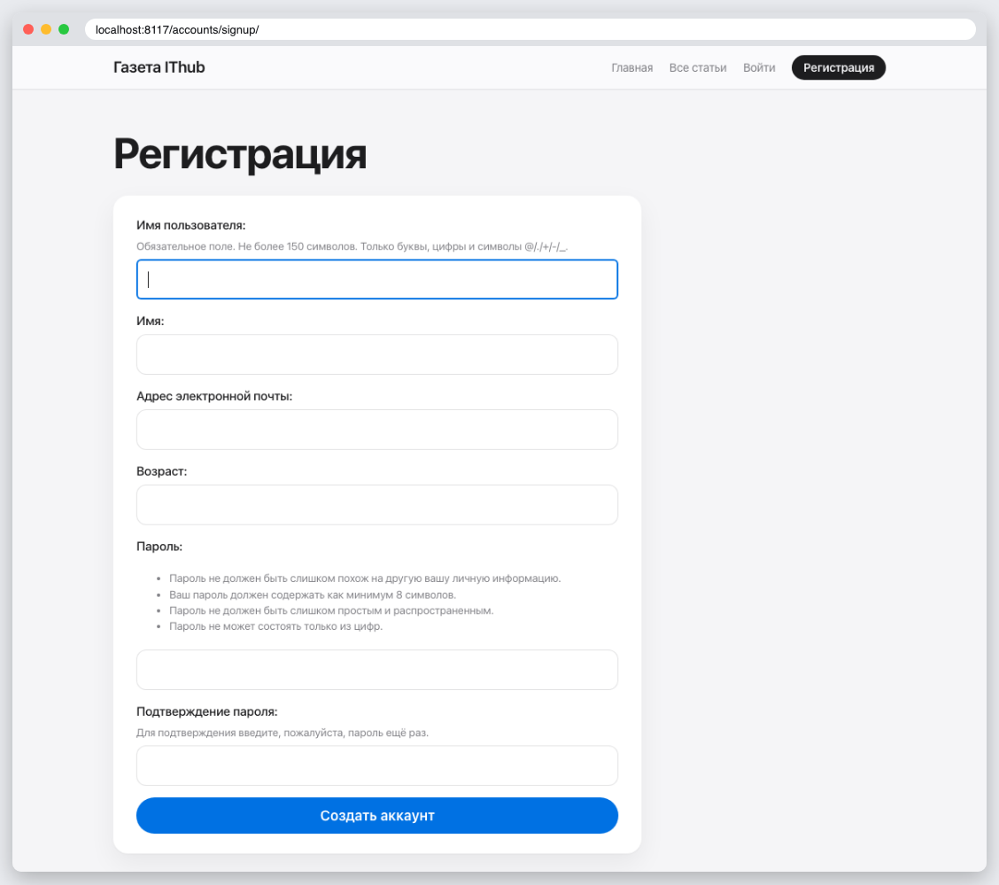
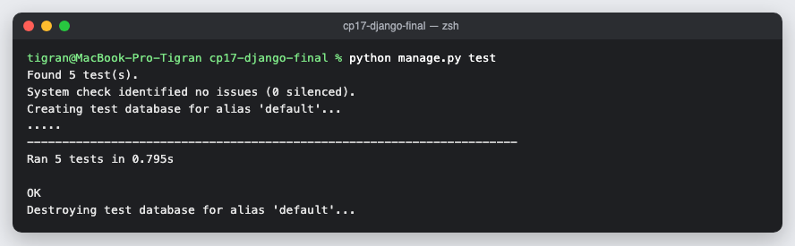

# КТ 17. Учётные записи пользователей — итоговое задание

«Газета IThub» — студенческая газета.

| Требование | Как выполнено |
|---|---|
| Вид приложения | газета: статьи по рубрикам, комментарии |
| Аутентификация и база данных | собственная модель пользователя `CustomUser` (возраст, о себе), регистрация с автоматическим входом, вход и выход, смена и сброс пароля; статьи и комментарии в базе |
| Шаблоны | `base.html` и шаблоны страниц, папка `registration` |
| CSS-файлы | `static/css/base.css` и `static/css/newspaper.css` |
| Переходы через заголовки | заголовки статей ведут на их страницы, в шапке ссылки на разделы |
| Оформление | светлая и тёмная темы, адаптивная вёрстка |

Написать статью и комментировать могут только вошедшие пользователи, изменить и удалить статью — только её автор. Демо-авторы `tigran`, `maria`, `daniil` создаются миграцией, пароль `newspaper123`.

## Запуск

```
python3 -m venv .venv
source .venv/bin/activate
pip install -r requirements.txt
python manage.py migrate
python manage.py runserver
python manage.py test
```

## Скриншоты







